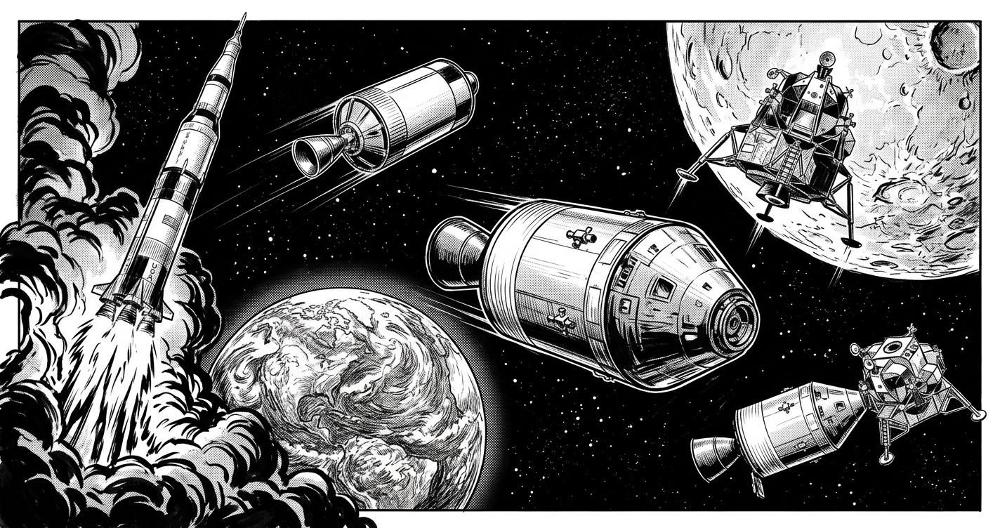

# Apollo Slide-Rule RPG

A cooperative pencil-and-paper role-playing game in which your flight crew
uses a slide rule to calculate burn pads, timing, navigation, and consumable
budgets for two Apollo-inspired missions.



## Play the game

Download the [player book](apollo-game.pdf) and
[referee answer key](apollo-answer-key.pdf). The game is self-contained:
**you do not need the original Apollo 11 flight-plan PDF to play.**

| Mission | Difficulty | Objective | Suggested session |
|---|---|---|---|
| Apollo 11 | Beginner | Land Eagle, conduct an EVA, rendezvous, and return home. | 90-150 minutes |
| Apollo 13 | Advanced | Use Aquarius as a lifeboat and recover all three crew. | 2-3 hours |

Play with one referee and one to three flight-crew players, or solo with the
answer panels covered until you commit each calculation.

You need pencils, erasers, scrap paper, printed mission worksheets, and a
slide rule with C/D and A scales. Apollo 13 also uses an L scale for its
rocket-equation exercise; a printed logarithmic scale may substitute.
Trigonometric scales are optional because the player book includes a
tangent table. Do not use electronic calculators during player calculations.

Each mission has ten checkpoints. Read the situation and telemetry, estimate
the order of magnitude, work the calculation, and commit a signed command
with units and a GO/NO-GO decision. The referee grades the first committed
sheet as GREEN, AMBER, or RED and narrates the appropriate outcome.

Apollo 11 begins with 6 command-reserve points; Apollo 13 begins with 4.
GREEN costs 0, AMBER costs 1, and RED costs 2. Errors must be corrected
before continuing. Reserve exhaustion ends the scored mission in the
appropriate abort or unresolved-rescue branch. Command reserve is an
abstract game track, not a fuel or life-support inventory.

The answer key contains all required calculation outlines, worked answers,
grading rules, and read-aloud narration for mission transitions, each
checkpoint's outcomes, and mission endings. Keep it separate from the
players' worksheets.

## Files

| File | Purpose |
|---|---|
| `apollo-game.pdf` | Printable player book, mission cards, reference sheet, and ledgers. |
| `apollo-answer-key.pdf` | Calculation outlines, solutions, referee rules, and narration appendix. |
| `apollo-game.tex` | Player-book LaTeX entry point. |
| `apollo-answer-key.tex` | Answer-key LaTeX entry point. |
| `apollo-missions.tex` | Shared calculation cards for both missions. |
| `apollo-narration.tex` | Referee read-aloud scripts. |
| `apollo-style.tex` | Shared page layout, formatting, and card definitions. |
| `apollo-sources.tex` | Historical references and modeling boundaries. |
| `apollo-cover-art.tex` | Shared cover-image inclusion. |
| `apollo-comic-cover.png` | AI-generated black-and-white comic-book cover artwork. |
| `flight_plan.txt` | Text rendition of NASA's Apollo 11 final flight plan, retained as a historical reference. |

`Apollo11_Flight_Plan.pdf` is deliberately excluded from this repository.
The committed game PDFs are included; LaTeX build intermediates are ignored.

## Build the PDFs

Use a LaTeX distribution that provides `pdflatex` and the packages referenced
in `apollo-style.tex`, including `geometry`, `fontenc`, `lmodern`,
`microtype`, `amsmath`, `amssymb`, `booktabs`, `tabularx`, `array`,
`xcolor`, `enumitem`, `tcolorbox`, `fancyhdr`, and `hyperref`.
The cover also uses `graphicx`; `tcolorbox` requires its usual PGF/TikZ
dependencies.

Run from the repository directory:

```sh
pdflatex -interaction=nonstopmode -halt-on-error apollo-game.tex
pdflatex -interaction=nonstopmode -halt-on-error apollo-game.tex
pdflatex -interaction=nonstopmode -halt-on-error apollo-answer-key.tex
pdflatex -interaction=nonstopmode -halt-on-error apollo-answer-key.tex
```

The second pass resolves references, including the answer key's narration
page reference. The build uses the included cover image and does not require
an image-generation service, API key, or the excluded flight-plan PDF.

## Historical sources and educational limits

Apollo 11 follows NASA's *Final Flight Plan, July 1, 1969*, using its
**planned** sequence rather than a reconstructed as-flown timeline.
The supplied flight-plan PDF and `flight_plan.txt` both describe Apollo 11,
not Apollo 13.

Apollo 13's rescue anchors are supplemented by the
[NASA NSSDCA Apollo 13 spacecraft catalog](https://nssdc.gsfc.nasa.gov/nmc/spacecraft/display.action?id=1970-029A).
Detailed citations appear in both books.

Resource inventories, simplified burn and entry models, reserve thresholds,
error consequences, and narration are invented educational game material.
Read-aloud dialogue is not a historical NASA transcript. The cover is an
artistic montage, not a technical drawing or scale illustration.

This is not flight software, an operational checklist, or a model of actual
mission survival. The cards contain all mandatory calculations for this
game, not every calculation performed during an Apollo mission.

## License

The repository includes the [GNU General Public License v3.0](LICENSE)
selected for this project. NASA reference material is attributed separately;
its inclusion does not imply NASA endorsement or ownership of that material
by this project's authors.
